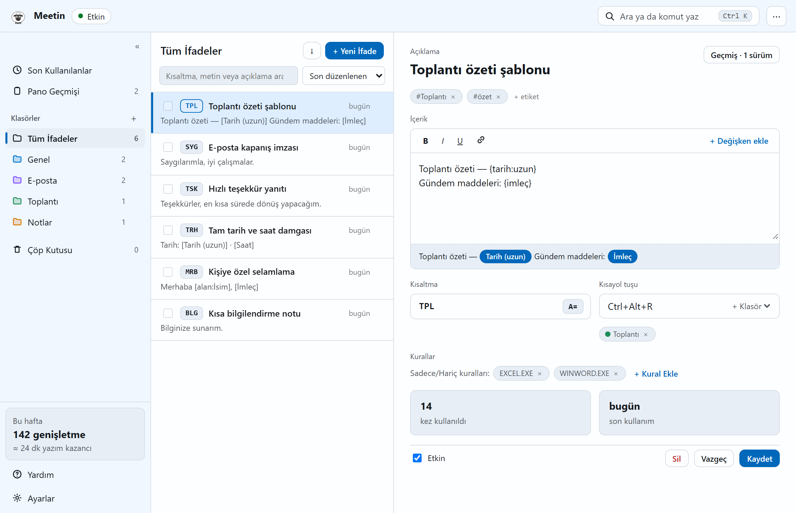
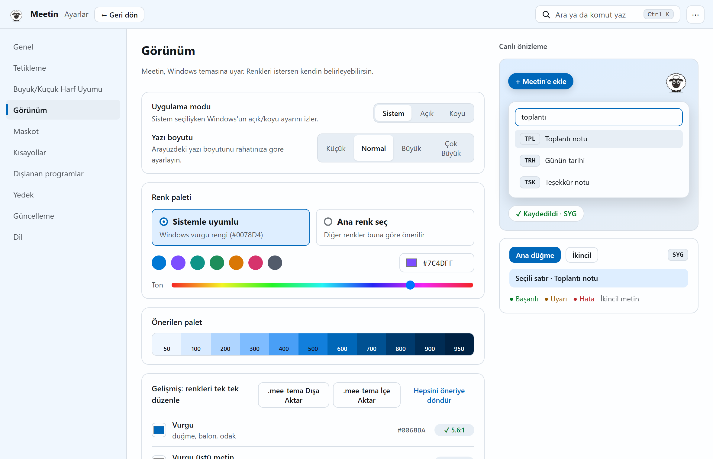

  

<h1 align="center">Meetin · Akıllı Türkçe Metin Genişletici (<code>v1.3.0</code>)</h1>

  Windows için tasarlanmış yerel, hızlı, gizlilik odaklı ve Türkçe (<code>tr-TR</code>) uyumlu akıllı metin genişletici ve etkileşimli masaüstü koyun maskotu.

---

## Ekran Görüntüleri

  
  &nbsp;
  

- **Masaüstü Koyun Maskotu ([meetin-maskot.svg](docs/meetin-maskot.svg)):** Sürüklenebilir, fırlatılabilir, tıklayınca arama adası ve seçili metinlerde anında `+ Ekle` balonu açan; sağ tıkla tek adımda **Sessize Al** / **Duraklat** seçenekleri sunan üretkenlik maskotu.

---

## Öne Çıkan Özellikler

- **Türkçe Büyük/Küçük Harf Uyumu (`tr-TR`):** `i ↔ İ`, `ı ↔ I` ayrımını bozmadan *Aynen getir* (varsayılan), *Harf uyumu* ve *Birebir eşleşme* modlarıyla genişletme + *Aksanları yoksay* seçeneği.
- **Kesintisiz `Shift+F3` Harf Döngüsü:** Hangi düzenlenebilir uygulamada olursan ol seçili metni Word tarzı `küçük → İlk harf büyük → TÜMÜ BÜYÜK` döngüsüyle dönüştürür ve seçimi korur; ardı ardına `Shift+F3` basarak devam edebilirsiniz.
- **Güçlü Kütüphane ve Klasör Yönetimi:**
  - Tek ifadeyi birden fazla klasörde bulundurma, klasörler arası serbest taşıma veya `Ctrl+sürükle` ile kopyalama.
  - **Toplu seçme**, sağ tık bağlam menüsü, klasörlere 8 farklı renk atama ve yeniden adlandırma.
  - İfadeyi **Çöp Kutusu**na sürükleyerek veya listede sola kaydırıp kırmızı **Sil** ile anında silme.
  - Kütüphanenin tamamını, bir klasörü ya da filtrelenmiş listeyi `.mee`, `CSV` veya `.ahk` olarak dışa aktarma.
- **Akıllı Otomatik İşlemler:** 650 ms otomatik kaydetme, içerik yazıldıkça otomatik açıklama doldurma (elle müdahale edilene dek), klasör adını etikete otomatik ekleme ve ayarlanabilir kısaltma önerisi (*İlk harfler*, *İlk kelime*, *Son kelime*, *Etiket*).
- **Pano Geçmişi ve Biçim Dönüştürücü:** Ayarlanabilir kayıt sayısı (varsayılan son 10 kopya); kayıtlı her metni tek tıkla *Kopyala*, *TÜMÜ BÜYÜK*, *tümü küçük*, *İlk Harf Büyük* olarak kopyalama.
- **Ayrı Ses Kontrolleri:** `Ayarlar › Maskot` üzerinden ana ses, *Mee sesi*, *Fırlatma sesi (whoosh)* ve *Duvar çarpma sesi* ayrı ayrı açılıp kapatılabilir.
- **Tema ve Yazı Boyutu Özelleştirme:** Windows açık/koyu modu ve vurgu rengini canlı izler; WCAG ≥ 4,5:1 karşıtlık güvenceli OKLCH paleti, `.mee-tema` paylaşımı ve **Küçük / Normal / Büyük / Çok Büyük** yazı boyutu sunar.
- **Windows 11 Mica / Acrylic Saydamlık & Canlı Çoklu Dil:** Ana pencerede gerçek DWM **Mica**, adalarda **Acrylic** arka plan (Windows 10'da düz Fluent geri düşümü) ve **Ayarlar › Dil** altından yeniden başlatmadan **Türkçe / English** geçişi sunar.
- **Canlı WYSIWYG & `.mee` Zengin Medya ZIP Arşivi:** Kalın, italik, altı çizili, sıralı/sırasız liste, URL doğrulamalı bağlantı ve gömülü görseller Word/Outlook'a eksiksiz aktarılır; `.mee` dosyaları görselleri `assets/` içinde tekilleştirerek standart ZIP olarak taşır (düz JSON `.mee`/`.meetin` ile geriye dönük uyumlu).
- **Uygulama İçi Yardım Merkezi (`F1`):** Tüm kısayollar, değişkenler, örnekler ve SSS için canlı aranabilir yardım merkezi içerir.
- **Güvenilir Yedekleme (`%APPDATA%\Meetin`) & İmzalı Güncelleme:** Tüm veriler kullanıcı `AppData\Roaming\Meetin\` klasöründe tutulur; açılışta ve kapanışta otomatik SQLite `VACUUM INTO` yedeği (30 kopya rotasyonu) alınır ve güncellemeler SHA-256 + ECDSA P-256 doğrulamasıyla tek tıkla kurulabilir.

---

## Varsayılan Kısayollar

| Kısayol | İşlev |
| --- | --- |
| `Ctrl + Alt + F` | Arama adasını aç |
| `Ctrl + Alt + E` | Seçili metinden hızlı ekle |
| `Ctrl + Alt + S` | Ana pencereyi aç |
| `Ctrl + Alt + P` | Motoru duraklat / sürdür |
| `Ctrl + Alt + Space` | Maskotu göster / gizle |
| `Ctrl + K` | Ana pencerede Komut Paleti |
| `F1` | Ana pencerede Yardım Merkezi |
| `Shift + F3` | Seçili metnin büyük/küçük harf biçimini değiştir (ardı ardına döngü) |

---

## İndirme ve Kurulum

- **Kurulumlu (NSIS):** [GitHub Releases](https://github.com/ismetuluer/meetin/releases/latest) üzerinden `Meetin_1.3.0_x64-setup.exe` indirip kurabilirsiniz.
- **Taşınabilir (Portable):** `Meetin_1.3.0_portable.zip` kurulum gerektirmeden çalışır ve verileri varsayılan olarak `%APPDATA%\Meetin\` altında saklar (yerel `.\data\` klasörüne almak için EXE yanına boş `local-data.flag` dosyası eklenebilir).
- **Doğrulamalı ve İmzalı Öz-Güncelleme:** Meetin yeni sürümleri doğrudan GitHub Releases (`v*` etiketi iş akışı: [release.yml](.github/workflows/release.yml)) üzerinden SHA-256 ve ECDSA P-256 imza doğrulamasıyla tek tıkla kurabilir ([İmzalama Rehberi](docs/GUNCELLEME_IMZALAMA.md)).
- **Geliştirme başlatma:** Projeden doğrudan çalıştırmak için [Start.bat](Start.bat) dosyasını kullanabilirsiniz.
- **Kullanıcı Kılavuzu & Yardım:** Ayrıntılı kullanım rehberi, değişkenler ve SSS için [docs/YARDIM.md](docs/YARDIM.md) dosyasını inceleyebilir veya uygulama içinde `F1` tuşuna basabilirsiniz.
- **Yol Haritası (Faz A–E):** Tamamlanan özelliklerin teknik özeti [docs/ATLANANLAR_YOL_HARITASI.md](docs/ATLANANLAR_YOL_HARITASI.md) dosyasında yer alır.

---

## Windows SmartScreen Uyarısı (§9)

Meetin açık kaynaklı ve kod imzalama sertifikası olmadan dağıtıldığı için Windows Defender SmartScreen ilk çalıştırmada *"Windows kişisel bilgisayarınızı korudu"* uyarısı gösterebilir. Devam etmek için **Ek bilgi** → **Yine de çalıştır** adımını seçebilirsiniz.
