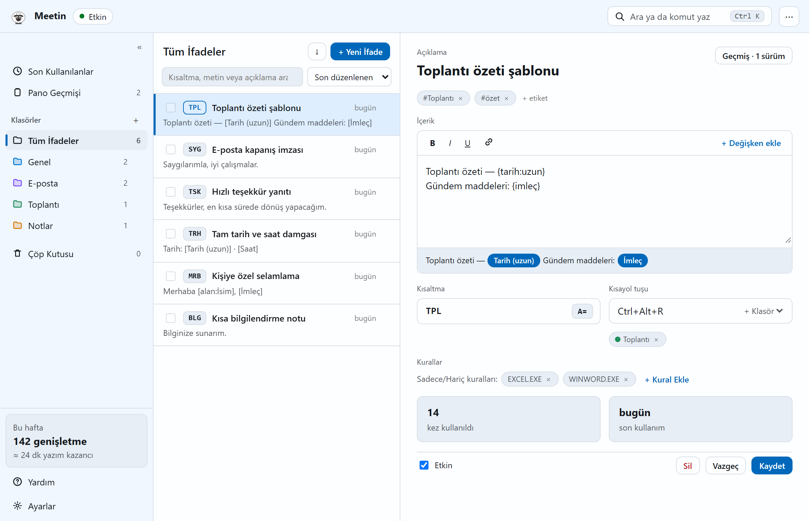
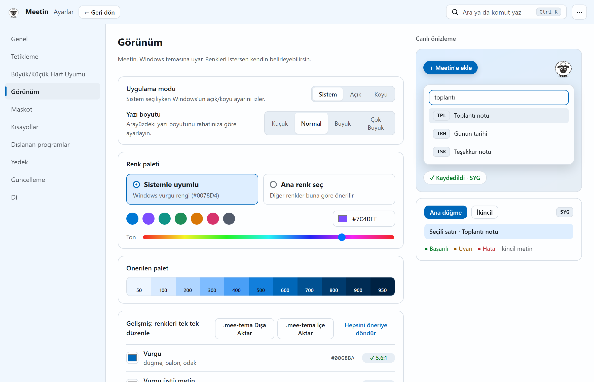

  

# Meetin Kullanıcı Kılavuzu

Meetin; Windows için tasarlanmış yerel, hızlı, gizlilik odaklı ve Türkçe (`tr-TR`) tam uyumlu akıllı metin genişletici ile etkileşimli masaüstü koyun maskotudur. Bu kılavuzda tüm özellikleri örneklerle bulabilirsiniz.

---

## İçindekiler

1. [Hızlı Başlangıç](#1-hızlı-başlangıç)
2. [Türkçe Harf Uyumu ve `Shift+F3`](#2-türkçe-harf-uyumu-ve-shiftf3)
3. [Değişkenler ve Form Alanları](#3-değişkenler-ve-form-alanları)
4. [Klasörler, Toplu İşlem ve Düzenleme](#4-klasörler-toplu-işlem-ve-düzenleme)
5. [Kısayollar ve Komut Paleti](#5-kısayollar-ve-komut-paleti)
6. [Pano Geçmişi](#6-pano-geçmişi)
7. [Maskot ve Ses Kontrolleri](#7-maskot-ve-ses-kontrolleri)
8. [İçe / Dışa Aktarma ve Yedekleme](#8-içe--dışa-aktarma-ve-yedekleme)
9. [Görünüm, Tema ve Yazı Boyutu](#9-görünüm-tema-ve-yazı-boyutu)
10. [Sık Sorulan Sorular](#10-sık-sorulan-sorular)

---

## 1. Hızlı Başlangıç

1. **İlk ifadenizi ekleyin:** Orta sütundaki **+ Yeni İfade** düğmesine tıklayın (veya herhangi bir programdayken `Ctrl+Alt+E` ile hızlı ekleme adasını açın).
2. **İçeriği yazın:** Genişletilecek tam metni girin. Açıklama alanı ilk satırdan otomatik doldurulur (elle değiştirirseniz sizin yazdığınız korunur).
3. **Kısaltmayı belirleyin:** Örn. `SYG`. Meetin yaptığınız tüm değişiklikleri **650 ms içinde otomatik kaydeder**.
4. **Her yerde kullanın:** Word, Excel, tarayıcı, e-posta veya not defterinde `SYG` yazıp bir tetikleyici tuşa (**Boşluk**, **Enter**, **Tab** veya noktalama) basın; metin anında genişler.

**Diğer pratik yollar:**
- Herhangi bir programda metin seçtiğinizde beliren **`+ Ekle`** balonuyla tek tıkla yeni ifade taslağı açabilirsiniz.
- **Ayarlar › Genel** altından otomatik kısaltma önerisi kuralını (*İlk harfler*, *İlk kelime*, *Son kelime*, *Etiket*) kendinize göre ayarlayabilirsiniz.

---

## 2. Türkçe Harf Uyumu ve `Shift+F3`

Meetin Türkçe (`tr-TR`) alfabe kurallarına göre çalışır: küçük `i` büyüdüğünde **`İ`**, küçük `ı` büyüdüğünde **`I`** olur.

| Simge | Mod Adı | Davranış |
| :---: | --- | --- |
| **A=** | **Aynen getir** *(Varsayılan)* | Kısaltmayı nasıl yazarsanız yazın, kayıtlı büyük/küçük harf biçimi korunur. |
| **Aa** | **Harf uyumu** | Yazdığınız kısaltmanın harf biçimine uyar: `syg` → `saygılarımla`, `Syg` → `Saygılarımla`, `SYG` → `SAYGILARIMLA`. |
| **AA** | **Birebir eşleşme** | Yalnızca kayıtlı büyük/küçük harf biçimiyle birebir yazıldığında genişler. |

- **Aksanları yoksay:** **Ayarlar › Harf uyumu** içinden açıldığında aksanlı ve noktalı/noktasız harfler esnek eşleştirilir.
- **`Shift+F3` Harf Döngüsü:** Düzenlenebilir herhangi bir uygulamada metin seçip `Shift+F3` bastığınızda seçili metin Türkçe kurallarıyla `tümü küçük → İlk harf büyük → TÜMÜ BÜYÜK` arasında döner. Dönüşümden sonra seçim korunur; elinizi kaldırmadan art arda `Shift+F3` basarak istediğiniz biçime geçebilirsiniz.

---

## 3. Değişkenler ve Form Alanları

İçerik araç çubuğundaki **`+ Değişken ekle`** menüsünü kullanabilir veya doğrudan süslü parantezlerle yazabilirsiniz:

| Değişken | Örnek Çıktı | Açıklama |
| --- | --- | --- |
| `{tarih}` | `26.11.2026` | Günün tarihini kısa biçimde ekler. |
| `{tarih:uzun}` | `26 Kasım 2026 Perşembe` | Ay ve gün adıyla tam Türkçe tarih ekler. |
| `{tarih:+1g}` | `+1g`, `-2h`, `+1a`, `-1y` | Tarihi gün (`g`), hafta (`h`), ay (`a`) veya yıl (`y`) bazında kaydırır. |
| `{saat}` | `18:05` | Güncel saati 24 saat biçiminde ekler. |
| `{pano}` | *(Panodaki son metin)* | Windows panosundaki metni şablona yerleştirir. |
| `{imleç}` | `Merhaba {imleç},` | Genişletme sonrasında imleci tam bu noktaya taşır. |
| `{alan:İsim}` | `Sayın {alan:İsim},` | Genişletme sırasında küçük pencere açarak sizden bilgi ister. |
| `{alan:Durum\|Acil,Normal,Düşük}` | Açılır liste | Çubuk (`\|`) sonrası virgülle ayrılan seçeneklerden liste sunar. |
| `{ifade:KISALTMA}` | `{ifade:SYG}` | Başka bir kayıtlı ifadeyi içeriğe gömer (döngü korumalıdır). |

İçerik üst çubuğundaki **B** *(Kalın)*, **I** *(İtalik)*, **U** *(Altı çizili)* ve bağlantı simgesiyle biçimli HTML/RTF çıktı üretebilirsiniz.

---

## 4. Klasörler, Toplu İşlem ve Düzenleme

- **Çoklu klasör üyeliği:** Aynı ifade birden fazla klasörde bulunabilir; ancak aynı kısaltma ikinci kez oluşturulamaz.
- **Sürükle-bırak taşıma / `Ctrl+sürükle` kopyalama:** İfadeleri sol menüdeki klasörlere sürükleyerek taşıyabilir, `Ctrl` basılı tutarak kopyalayabilirsiniz.
- **Otomatik klasör etiketi:** Klasör seçtiğinizde veya klasör içinden yeni ifade oluşturduğunuzda klasör adı etiketlere otomatik eklenir (elle düzenleyebilirsiniz).
- **Klasör renkleri ve sağ tık menüsü:** Klasörlere sağ tıklayarak 8 renkten birini atayabilir, yeniden adlandırabilir, yalnızca o klasörü dışa aktarabilir veya silebilirsiniz.
- **Toplu seçme ve toplu işlem:** Onay kutuları, `Ctrl+tık` veya `Shift+tık` ile birden fazla ifadeyi seçip üst çubuktan taşıyabilir, kopyalayabilir, `.mee` olarak dışa aktarabilir veya silebilirsiniz.
- **Sola kaydırarak veya Çöp Kutusuna atarak silme:** Satırı sola kaydırıp (dokunmatik yüzey veya `‹` düğmesi) beliren kırmızı **Sil** ile ya da Çöp Kutusuna sürükleyerek silebilirsiniz.
- **Daraltılabilir sol menü:** Sol üstteki `«` / `»` düğmesiyle yan menüyü daraltabilirsiniz.
- **Uygulama kuralları ve Sürüm geçmişi:** Açık pencereler listesinden hedef uygulama seçerek kural tanımlayabilir, geçmiş sürümlerden birini tek tıkla geri yükleyebilirsiniz.

---

## 5. Kısayollar ve Komut Paleti

> Global kısayolları **Ayarlar › Kısayollar** bölümünden değiştirebilirsiniz.

| Kısayol | İşlev |
| --- | --- |
| `Ctrl + Alt + F` | Arama adasını aç |
| `Ctrl + Alt + E` | Seçili metinden hızlı ifade ekle |
| `Ctrl + Alt + S` | Ana pencereyi aç / öne getir |
| `Ctrl + Alt + P` | Genişletme motorunu duraklat / sürdür |
| `Ctrl + Alt + Space` | Masaüstü maskotunu göster / gizle |
| `Shift + F3` | Seçili metnin büyük/küçük harf biçimini döndür (ardı ardına) |
| `Ctrl + K` | Ana pencerede Komut Paleti |
| `F1` | Ana pencerede Yardım Merkezi |

---

## 6. Pano Geçmişi

- Kopyaladığınız metinler varsayılan olarak son **10 kopya**ya kadar saklanır (**Ayarlar › Genel** üzerinden sınır değiştirebilir veya kapatabilirsiniz).
- Sol menüdeki **Pano Geçmişi** ekranından her kaydı tek tıkla **Kopyala**, **TÜMÜ BÜYÜK**, **tümü küçük** veya **İlk Harf Büyük** biçiminde panoya alabilir, dilerseniz **+ İfade Yap** düğmesiyle kısaltmaya dönüştürebilirsiniz.

---

## 7. Maskot ve Ses Kontrolleri

- **Sol tık:** Arama adasını açar; aradığınız ifadeyi `Enter` ile doğrudan yazdığınız pencereye yapıştırır.
- **Çift tık:** Meetin ana penceresini öne getirir.
- **Sürükle ve fırlat:** Koyunu ekranda sürükleyip fırlatarak duvardan sektirebilirsiniz.
- **Sağ tık:** Doğrudan **Sessize Al / Sesi Aç**, **Mini Oyun: Basketbol**, **Meetin'i Aç**, **Gizle** ve **Çıkış** seçeneklerini sunar.
- **Ayrı ses denetimleri:** **Ayarlar › Maskot** altında ana ses anahtarına ek olarak *Mee sesi*, *Fırlatma sesi* ve *Duvar çarpma sesi* ayrı ayrı açılıp kapatılabilir ve test edilebilir.

---

## 8. İçe / Dışa Aktarma ve Yedekleme

- **Esnek dışa aktarma:** Sağ üst `⋯` menüsünden tüm kütüphaneyi, orta liste başlığından o anda görünen/filtrelenen listeyi, sağ tık menüsünden seçili klasörü veya seçili ifadeleri `.mee`, `CSV` ya da `.ahk` olarak dışa aktarabilirsiniz.
- **Çoklu içe aktarma:** `.mee`, `.meetin`, `CSV` (UTF-8 / Windows-1254 algılamalı), `.ahk` ve `.txt` dosyalarını çakışma kuralı (*Atla / Üzerine yaz / Yeni kısaltma öner*) seçerek aktarabilirsiniz.
- **Veri konumu ve otomatik yedekleme:** Veriler `%APPDATA%\Meetin\` klasöründe tutulur; açılış ve kapanışta otomatik SQLite `VACUUM INTO` yedeği (30 kopya rotasyonu) alınır. Taşınabilir sürümde EXE yanına boş `local-data.flag` dosyası eklenirse yerel `.\data\` klasörü kullanılır.

---

## 9. Görünüm, Tema ve Yazı Boyutu

- **Sistem uyumu ve OKLCH palet:** Windows açık/koyu modunu ve sistem vurgu rengini otomatik takip eder veya seçtiğiniz ana renkten WCAG ≥ 4,5:1 kontrast güvenceli palet üretir. Temalar `.mee-tema` olarak paylaşılabilir.
- **Yazı boyutu:** **Ayarlar › Görünüm** üzerinden **Küçük (`12px`)**, **Normal (`14px`)**, **Büyük (`16px`)** ve **Çok Büyük (`18px`)** seçenekleriyle tüm arayüz yazı boyutunu ayarlayabilirsiniz.

---

## 10. Sık Sorulan Sorular

- **Kısaltmayı yazıyorum ama genişlemiyor:** Üst çubuktaki durumun **Etkin** olduğunu kontrol edin. Hedef program *Dışlanan programlar* listesinde olabilir veya ifadenin uygulama kuralı başka bir programa kısıtlı olabilir. Yönetici yetkili pencerelerde genişletme için **Ayarlar › Genel** içinden *Yönetici yetkili başlangıç* seçeneğini kullanın.
- **`Shift+F3` bazı pencerelerde çalışmıyor:** Yalnızca metin seçilebilen ve düzenlenebilen alanlarda aktiftir; salt okunur sayfalarda ve parola alanlarında değişiklik yapmaz.
- **Parola alanları kaydediliyor mu?** Hayır. Windows UI Automation (`IsPassword`) parola kutuları otomatik atlanır ve tampona/panoya alınmaz.
- **Windows SmartScreen uyarısı:** Meetin kod imzalama sertifikası olmadan açık kaynak dağıtıldığı için ilk çalıştırmada uyarı verebilir; **Ek bilgi → Yine de çalıştır** adımıyla devam edebilirsiniz.
